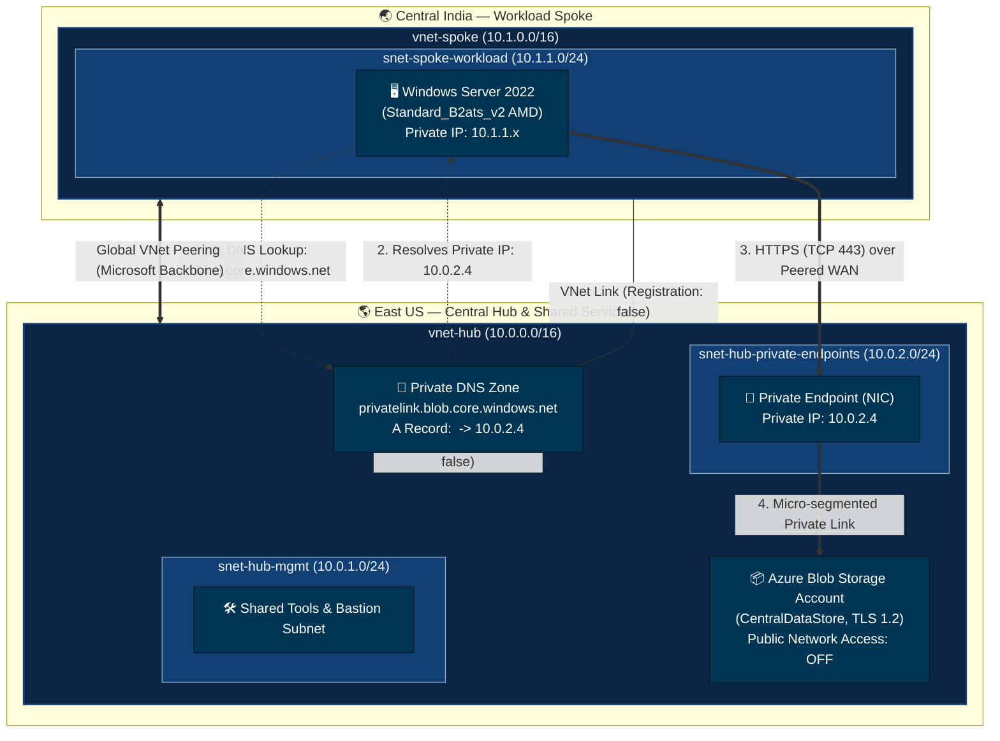

<div align="center">

# 🛡️ Enterprise Azure Private Endpoint Landing Zone
### Secure Hub-and-Spoke Topology with Private DNS, Blob Storage & Cross-Region Workload

[](https://www.terraform.io/)
[](https://registry.terraform.io/providers/hashicorp/azurerm/latest)
[](https://learn.microsoft.com/en-us/azure/architecture/reference-architectures/hybrid-networking/hub-spoke)
[](LICENSE)

<p align="center">
  A production-hardened, modular Azure infrastructure template implementing <b>Zero Trust</b> principles for cloud storage access.<br>
  Engineered with a <b>nested-map / dictionary-driven</b> architecture that eliminates boilerplate and scales effortlessly.
</p>

</div>

---

## 💡 Why This Project Exists

In enterprise environments, exposing data services to the public internet is a major security risk. Simply putting firewall rules on a storage account isn't enough when compliance frameworks require that **no public IP ever touches your storage plane**.

This landing zone solves that problem with a real-world, battle-tested architecture:
- 🔒 **Zero Internet Exposure:** Public network access to Azure Blob Storage is completely disabled at the infrastructure layer (`public_network_access_enabled = false`).
- 🌐 **Global Backbone Connectivity:** Your workload VM in **Central India** communicates seamlessly with central shared storage in **East US** across Microsoft's private high-speed global WAN—bypassing the public internet entirely.
- ⚡ **Automated DNS Resolution:** A Private DNS Zone (`privatelink.blob.core.windows.net`) is linked to both virtual networks, allowing private DNS records to resolve transparently from any connected workload.
- 🧱 **100% Modular & Reusable:** Built using independent child modules orchestrated through clean nested maps (`terraform.tfvars`). No copy-pasting resource blocks; iterate with `for_each`.

---

## 🏛️ Architecture & Network Design



### Traffic Flow Walkthrough
1. **DNS Query:** The Windows VM in Central India queries `<storage_account>.blob.core.windows.net`.
2. **Private Resolution:** Because the Spoke VNet is linked to the Private DNS Zone, Azure DNS returns the Private Endpoint IP (`10.0.2.4`) instead of a public IP.
3. **Peering Routing:** The VM routes outbound HTTPS traffic directly through the cross-region Global VNet Peering to the Hub VNet.
4. **Data Isolation:** Traffic lands on the Private Endpoint NIC in `snet-hub-private-endpoints` and accesses the Blob storage service safely behind Azure Private Link.

---

## 📂 Repository Structure

```text
Azure-Private-Endpoint-Landing-Zone/
├── modules/                                  # 🧩 Reusable, standalone child modules
│   ├── resource_group/                       # Azure Resource Groups
│   ├── network/                              # VNets, Subnets, and Bidirectional Peerings
│   ├── storage/                              # Storage Accounts, Containers & Random Suffix
│   ├── private_dns/                          # Private DNS Zones, VNet Links & A Records
│   ├── private_endpoint/                     # Private Endpoints with DNS Zone Groups
│   └── windows_vm/                           # Windows VM (Standard_B2ats_v2), NIC, NSG & PIP
│
├── root/                                     # 🚀 Root Orchestration Layer
│   └── Dev/                                  # Development / Staging Environment
│       ├── versions.tf                       # Provider requirements (azurerm ~> 5.10.0, random ~> 3.6)
│       ├── variables.tf                      # Strict schema type definitions for nested maps
│       ├── main.tf                           # Module invocation & dependency wiring
│       ├── outputs.tf                        # Clean diagnostic outputs & verification commands
│       ├── terraform.tfvars                  # Centralized infrastructure specification
│       └── terraform.tfvars.example          # Safe template for version control & team onboarding
│
├── .gitignore                                # Excludes state files, lock overrides, and sensitive data
├── LICENSE                                   # MIT License
└── README.md                                 # Project documentation
```

---

## 🧩 The Modular Philosophy: Nested Map Dictionaries

Instead of duplicating module blocks for each new subnet, VNet, or storage account, this codebase uses **dictionary-driven Terraform patterns**. Everything is configured through clean, expressive nested maps in [`root/Dev/terraform.tfvars`](file:///d:/DevOps/Terrraform%20Practice/Private%20End%20Point/Azure-Private-Endpoint-Landing-Zone/root/Dev/terraform.tfvars):

```hcl
# Example: Declarative Private DNS Zone with Nested A Records & VNet Links
private_dns_zones = {
  "blob_dns" = {
    name                = "privatelink.blob.core.windows.net"
    resource_group_name = "rg-hubspoke-storage-prod"
    linked_vnets        = ["vnet-hub", "vnet-spoke"]
    tags                = { Service = "PrivateDNS", Environment = "Production" }

    # ✨ A Records declared directly inside the zone dictionary
    a_records = {
      "stg_blob_pe_record" = {
        name       = "stghubprod01"
        ip_address = "10.0.2.4"
        ttl        = 300
        tags       = { RecordType = "StoragePrivateEndpoint" }
      }
    }
  }
}
```

### Why this is a game-changer:
- **Zero code edits** in `.tf` files when adding a second spoke, another container, or an additional DNS record.
- **Single source of truth**: Operators only modify `terraform.tfvars` to customize their environments.
- **Fail-safe references**: The modules automatically flatten maps and resolve cross-resource IDs without race conditions.

---

## ⚡ Quickstart & Deployment Guide

### Prerequisites
- [Terraform CLI](https://developer.hashicorp.com/terraform/downloads) `v1.5.0` or higher
- [Azure CLI (`az`)](https://learn.microsoft.com/en-us/cli/azure/install-azure-cli) logged in with adequate permissions:
  ```powershell
  az login
  az account set --subscription "<YOUR_SUBSCRIPTION_ID>"
  ```

### Step-by-Step Provisioning

1. **Clone the repository:**
   ```bash
   git clone https://github.com/<your-username>/Azure-Private-Endpoint-Landing-Zone.git
   cd Azure-Private-Endpoint-Landing-Zone/root/Dev
   ```

2. **Initialize Terraform & Providers:**
   ```powershell
   terraform init
   ```

3. **Inspect the Execution Plan:**
   ```powershell
   terraform plan
   ```

4. **Apply Infrastructure:**
   ```powershell
   terraform apply
   ```

---

## 🧪 Post-Deployment Verification

Once `terraform apply` finishes, Terraform will output diagnostic helpers, including RDP connection strings and automated verification commands.

### 1. Connect to the Windows Workload VM
Use the generated RDP command output:
```powershell
# Get your VM public IP
terraform output vm_public_ips

# Launch Windows Remote Desktop
mstsc /v:<VM_PUBLIC_IP>
```

### 2. Verify Private DNS & Private Endpoint Connectivity
Open **PowerShell** inside the Windows VM and run:

```powershell
# Test 1: Confirm the storage hostname resolves to the PRIVATE IP (10.0.2.x), NOT a public IP
Resolve-DnsName -Name "<storage_account_name>.blob.core.windows.net"

# Test 2: Verify TLS/TCP 443 connectivity through Private Link over VNet Peering
Test-NetConnection -ComputerName "<storage_account_name>.blob.core.windows.net" -Port 443
```

> **Expected Outcome:**  
> - `Resolve-DnsName` returns the private IP (`10.0.2.4`) in the Hub subnet.  
> - `Test-NetConnection` returns `TcpTestSucceeded : True`.

---

## 🛡️ Production Best Practices Implemented

| Category | Implementation Detail | Benefit |
|---|---|---|
| **Networking** | Hub-and-Spoke with Global VNet Peering | Segregates shared ingress/management from production workload compute. |
| **Data Protection** | `public_network_access_enabled = false` | Prevents data exfiltration and blocks unauthorized internet access. |
| **Transport Security** | `min_tls_version = "TLS1_2"` | Complies with modern SOC2, PCI-DSS, and ISO 27001 standards. |
| **Compute Resiliency** | `Standard_B2ats_v2` (AMD 2 vCPU / 1 GiB) | Cost-optimized burstable compute ideal for jumpbox/worker workloads. |
| **Provider Modernization** | AzureRM Provider `v5.10.0` | Uses modern resource arguments (`private_dns_zone_id`, `storage_account_id`). |
| **Secrets Hygiene** | Sensitive outputs & gitignored tfstate | Prevents accidental credentials leaks in CI/CD logs and repositories. |

---

## 🤝 Contributing

Contributions, issues, and feature requests are welcome!  
Feel free to open an issue or submit a Pull Request if you'd like to extend this landing zone with Azure Bastion, Firewall, or Key Vault integrations.

---

## 📜 License

This project is licensed under the [MIT License](LICENSE) — free to use and adapt for personal, enterprise, and educational projects.
